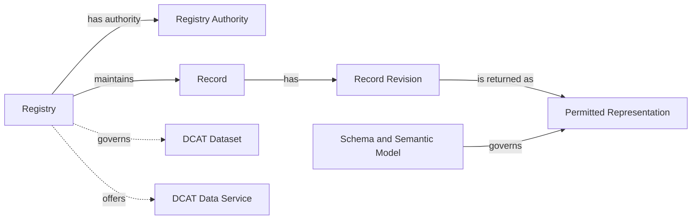

## Registry Core <a href="#core-registry-core" id="core-registry-core"></a>

> **Status:** DRAFT. See [requirement maturity](../introduction/scope.md#conformance-requirement-maturity).

### Purpose and applicability <a href="#core-purpose-and-applicability" id="core-purpose-and-applicability"></a>

Registry Core defines the common behaviour and metadata shared by the API families. It identifies the Registry, its authority and scope, and its available services. Returned Records have stable identity within an unambiguous Registry context and a documented representation schema. A capability or domain profile can additionally require revision, lifecycle, provenance, or formal semantic-model information.

Core is the interoperability boundary of this specification. Two implementations that conform to Core and the same capability expose the same operation shapes, error model, pagination, discovery mechanism and Record envelope. They do not expose the same domain fields: each deployment declares its own Record schemas in its published contract, and a domain profile can narrow them. Consumers can reuse protocol and envelope handling across Registries; domain-specific inputs and interpretation still require integration against each published contract.

The [draft conformance model](../introduction/scope.md#conformance-draft-conformance-model) combines service discovery with at least one selected Registry information operation. Core requirements apply as follows:

- Registry metadata and service discovery apply to every implementation.
- Record representation requirements apply to implemented capabilities that return Records.
- Identifier preservation applies where the implementation assigns or maintains Record Identifiers.
- The OpenAPI Registry context extension applies to selected Collection-scoped Consultation operations.

[Provisioning](../introduction/scope.md#not-covered) describes possible future administrative operations for creating or revising metadata. Publication can also use a static document or an external catalogue.

### Conceptual model <a href="#core-conceptual-model" id="core-conceptual-model"></a>



The model describes externally observable concepts. An implementation can operate one or more Registries, each with one or more technical services.

### Registry metadata <a href="#core-registry-metadata" id="core-registry-metadata"></a>

Registry metadata describes the institutionally governed Registry and its relationships to datasets, technical services, and catalogues. An implementation publishes it as one JSON document, as described under [Discovery publication](#core-discovery-publication). The keys below are defined by the [metadata document schema](../api/extensions/registry-metadata.schema.json). The [metadata vocabulary appendix](#vocabulary-metadata-vocabulary-informative) explains their DCAT and RDF meaning for catalogue integrators; producing or consuming the document does not require RDF tooling.

#### Minimal metadata <a href="#core-minimal-metadata" id="core-minimal-metadata"></a>

| Concept | JSON key | Status | Meaning |
|---|---|---|---|
| Registry Identifier | `@id` of the Registry | Required | Globally unique and stable identifier for the Registry. |
| Registry Name | `title` | Required | Human-readable name used by adopters and consumers. |
| Registry Authority | `authority` | Required | Institution accountable for the Registry and its declared authoritative scope. |
| Digital Registries specification reference | `specification` | Required | Identifies the versioned Digital Registries specification used to describe the implementation. |
| Description and authoritative scope | `description` | Required | Describes the information for which the named authority accepts responsibility, including relevant domain or jurisdictional boundaries. |
| Governed dataset | `governedDataset` | Not required and repeatable | A governed collection of Registry Records described for discovery or exchange. |
| Data service | `dataService` | Required for each exposed Registry service; repeatable | Associates the Registry with each interface exposed through the Digital Registries capability model. |

The scope description states the information for which the Registry Authority accepts responsibility and can reference a fuller scope or mandate document. The Registry Authority, Registry Operator, and catalogue publisher are distinct roles that can be held by the same or different organisations. The adopting ecosystem determines how it accepts or verifies authority declarations. Publication alone does not establish institutional responsibility.

The Registry Identifier and `authority` are absolute IRIs. A publisher can use an HTTPS URI under a domain it controls, a URN, or an identifier already assigned by an organisation or dataset register. Consumers compare these identifiers and do not need to dereference them.

`specification` identifies the specification version used to describe the implementation. A formal claim against an applicable approved specification or profile uses `conformsTo`. [Conformance](../introduction/scope.md#conformance-requirement-maturity) defines the conditions for such claims.

<a id="core-service-declarations"></a>

#### API family discovery <a href="#core-api-family-discovery" id="core-api-family-discovery"></a>

Each service exposed through the Digital Registries capability model identifies its supported API families with `serviceType` values on its data service description. Each value is a concept from the **Digital Registries API Families** scheme, abbreviated by the `apif:` prefix. Declarations cover Registry services available to the metadata's intended audience.

| `serviceType` value | API family |
|---|---|
| `apif:consultation` | Consultation |
| `apif:provisioning` | Provisioning |
| `apif:evidence` | Evidence |
| `apif:write` | Write |
| `apif:notification` | Notification |
| `apif:aggregate-data` | Aggregate Data |
| `apif:access-transparency` | Access Transparency |
| `apif:identity-federation` | Identity Federation |

An API-family value means that the data service exposes at least one operation assigned to that family. Supported operations are defined in the contract linked by `endpointDescription`. Family classification alone establishes neither support for every operation in the family nor a conformance claim.

Service metadata includes the service identifier, family classifications, `endpointURL`, and `endpointDescription`. The linked contract is machine-readable. HTTP operations use OpenAPI, or a protocol-native machine-readable description where the selected binding defines one. Parameters, request and response schemas, outcomes, and access requirements are defined in that contract. The metadata supports service discovery; automatic selection and invocation of equivalent operations across implementations is outside this discovery model.

A service description declares only the families available for its associated Registry. Where a shared API offers different families for different Registries, each Registry uses a separate logical data service description. Those descriptions can share an endpoint or contract URI.

#### API composition <a href="#core-api-composition" id="core-api-composition"></a>

One API can expose several logical Record Collections and operations from several families. A Collection is an addressable API grouping with declared membership, not an assertion that its Records occupy one table, source module, governed dataset, or institutionally separate Registry. Its `collectionId` is stable within the API contract. One Registry can expose several Collections, and one Record can be a member of several Collections while retaining the same identity. Its contract documents each Collection's membership and each operation's inputs, representation, and access requirements. API-family classifications describe capabilities independently of URL structure.

An OpenAPI contract declares the Registry context of each Collection-scoped read operation with the `x-govstack-digital-registries` extension on the Operation Object. The extension requires four values: `registry`, the Registry Identifier, equal to the `@id` of a Registry in the published metadata; `collection`, equal to `{collectionId}` in the operation path or its fixed concrete value; `capability`, one of `retrieve`, `lookup`, `list`, `search`, `revision-list`, and `revision-retrieve`; and `view`, the name of the Record view the operation returns. Its `features` array, which can be omitted, selects the additional guarantees defined by [Consultation](registry-services.md#consultation-selectable-read-features), including recorded-time, effective-time, and purpose binding; omission or an empty array selects none. An operation selecting `purpose-bound` also declares the extension's `purpose` object. The [extension schema](../api/extensions/x-govstack-digital-registries.schema.json) is its normative definition, and its capability and feature values are closed for that versioned contract. Operations of one Collection that declare the same view return the same Record schema. History operations can declare a distinct view, such as `record-history`. The Write operation extension declares the Registry, Collection where applicable, capability, input schema, and operation-specific binding for primary Write operations in the same OpenAPI contract. An Update or Transition declaration identifies the shared `retrieveRecord` companion read for the exact same Registry, Collection, and view. The extensions are machine-readable links between operations and the metadata that identifies the Registry and authority; the [Common Record context](registry-services.md#core-common-record-context) relies on them. The caller capability document has its own bounded schema and references caller-visible Consultation, Write, and supporting workflow operations. Collection-scoped entries appear under `collections`; cross-Collection Change Request and asynchronous Operation entries appear under optional root `operations` with their Registry context. A recognised Consultation entry requires `view` and can carry read annotations. Existing recognised read entries can omit `family` and are interpreted as Consultation. A new Write or supporting workflow entry declares `family: write` and cannot carry those read annotations, while Update and Transition entries identify their companion read. Unknown future capability entries remain skippable without acquiring known read or Write fields. The advisory capability and feature annotations are separately extensible under [Consultation](registry-services.md#consultation-operations). The `capability` property is binding vocabulary mapped to the framework option keys in the [overview](../introduction/overview.md#functionalities); it is not a framework capability declaration.

```yaml
  /v1/collections/businesses/records/{recordId}:
    get:
      operationId: retrieveBusiness
      x-govstack-digital-registries:
        registry: https://registry.example/registries/business
        collection: businesses
        capability: retrieve
        view: business-public
```

Operations from different families can share a resource URI through distinct HTTP methods. For example, Consultation can retrieve a Record at a URI where Write accepts an update. Each operation defines its own request and response schemas and permissions. The API contract coordinates collection, action, and supporting-resource paths, including any schema, subscription, or asynchronous-operation resources.

The major version applies to the API contract exposed at that root. Separately exposed APIs can evolve under their own versions. Protocol-specific bindings follow their protocol's endpoint and versioning conventions.

#### Discovery publication <a href="#core-discovery-publication" id="core-discovery-publication"></a>

An implementation publishes its Registry metadata as one document compacted with the version 1 JSON-LD context and served as `application/ld+json`. The [metadata document schema](../api/extensions/registry-metadata.schema.json) defines the compacted shape; the JSON-LD context defines its RDF meaning for consumers that want it. The [adopter kit](#artifact-inventory-adopter-kit) lists this document alongside the other published artifacts. The document describes one or more Registries, their governed datasets, and their services. The document URI identifies the document; each Registry has its own Registry Identifier. The document URI is chosen by the deployment, is stable, and is not part of the versioned API surface.

Consumers locate the document through the [RFC 9727](https://www.rfc-editor.org/rfc/rfc9727.html) API catalog. The origin that hosts a Digital Registries API serves `/.well-known/api-catalog` as an [RFC 9264 linkset](https://www.rfc-editor.org/rfc/rfc9264.html) in `application/linkset+json`, following the GET, HEAD, and HTTPS requirements of RFC 9727. For every Digital Registries API at that origin, the linkset carries a `service-desc` link to the OpenAPI contract and a `service-meta` link, typed `application/ld+json`, to the Registry metadata document. Both link relations are defined by [RFC 8631](https://www.rfc-editor.org/rfc/rfc8631.html). The well-known path is one of the unversioned paths the GovStack API Design Guide permits, so no other root path is needed for discovery. The [canonical OpenAPI contract](../resources/api.yml) describes `GET` and `HEAD` on this path, including the `Link` header with the `api-catalog` relation, at the origin root outside any deployment routing prefix.

The linkset below publishes the unified Registry contract, the separate informative Evidence contract, and the metadata document of the [informative example](#core-informative-json-ld-example). It is also available as a [file](../api/examples/api-catalog.linkset.json).

```json
{
  "linkset": [
    {
      "anchor": "https://registry.example/",
      "service-desc": [
        {
          "href": "https://registry.example/contracts/1.0.0-draft/openapi.yaml",
          "type": "application/vnd.oai.openapi",
          "title": "Business Registry API"
        },
        {
          "href": "https://registry.example/contracts/business-evidence.openapi.json",
          "type": "application/vnd.oai.openapi+json",
          "title": "Business Registry Evidence API"
        }
      ],
      "service-meta": [
        {
          "href": "https://registry.example/catalog",
          "type": "application/ld+json",
          "title": "Registry metadata for the Business Registry"
        }
      ]
    }
  ]
}
```

An entry in an external catalogue, such as a national data portal, can repeat the metadata but does not replace the well-known resource. Declarations are scoped to the intended metadata audience. Missing declarations establish neither the absence of an undisclosed service nor a consumer's entitlement to use it.

#### Informative JSON-LD example <a href="#core-informative-json-ld-example" id="core-informative-json-ld-example"></a>

This JSON-LD document describes a business Registry, its authority and governed dataset, and two logical services at a shared API endpoint. One unified Registry service supports Consultation and Write; a separate informative service supports Evidence. The GovStack context maps JSON properties to the RDF vocabulary and identifies IRI-valued properties. The specification IRI is illustrative; publication status is listed under [coverage and limitations](../introduction/scope.md#coverage-and-limitations).

The Registry service entry illustrates one contract that exposes independently authorised Consultation and Write operations. The document is also available as a [file](../api/examples/registry-metadata.jsonld) and validates against the metadata document schema. Its own URI, `https://registry.example/catalog`, is the `service-meta` target of the linkset above.

```json
{
  "@context": "https://vocab.govstack.global/digital-registries/context/v1",
  "@graph": [
    {
      "@id": "https://registry.example/catalog",
      "@type": "dcat:Catalog",
      "title": "Business Registry catalogue",
      "description": "Discovery metadata for the Business Registry, its dataset, and its APIs.",
      "publisher": "https://registry.example/organisations/business-authority",
      "catalogResource": "https://registry.example/registries/business",
      "catalogDataset": "https://registry.example/datasets/business-records",
      "catalogService": [
        "https://registry.example/services/business-registry",
        "https://registry.example/services/business-evidence"
      ]
    },
    {
      "@id": "https://registry.example/registries/business",
      "@type": [
        "govreg:Registry",
        "dcat:Resource"
      ],
      "title": "Business Registry",
      "description": "Authoritative business registrations in Example Jurisdiction, including registered names and registration status. Tax status is outside this Registry's scope.",
      "specification": "https://specs.govstack.example/digital-registries/3.0.0-alpha.2",
      "authority": "https://registry.example/organisations/business-authority",
      "governedDataset": "https://registry.example/datasets/business-records",
      "dataService": [
        "https://registry.example/services/business-registry",
        "https://registry.example/services/business-evidence"
      ]
    },
    {
      "@id": "https://registry.example/organisations/business-authority",
      "@type": "prov:Organization",
      "title": "Business Registration Authority"
    },
    {
      "@id": "https://registry.example/datasets/business-records",
      "@type": "dcat:Dataset",
      "title": "Business registration records dataset",
      "description": "Governed collection of business registration Records.",
      "publisher": "https://registry.example/organisations/business-authority"
    },
    {
      "@id": "https://registry.example/services/business-registry",
      "@type": "dcat:DataService",
      "title": "Business Registry API",
      "description": "Reads permitted business Records and accepts separately authorised direct or governed changes.",
      "serviceType": [
        "apif:consultation",
        "apif:write"
      ],
      "servesDataset": "https://registry.example/datasets/business-records",
      "endpointURL": "https://registry.example",
      "endpointDescription": "https://registry.example/contracts/1.0.0-draft/openapi.yaml"
    },
    {
      "@id": "https://registry.example/services/business-evidence",
      "@type": "dcat:DataService",
      "title": "Business Registry Evidence API",
      "description": "Produces signed assertions derived from permitted business registration information.",
      "serviceType": "apif:evidence",
      "endpointURL": "https://registry.example",
      "endpointDescription": "https://registry.example/contracts/business-evidence.openapi.json"
    }
  ]
}
```

The example uses untagged strings for readability. Deployments can use JSON-LD language maps, such as `"title": {"en": "Business Registry"}`, when publishing multilingual labels.

The [metadata vocabulary appendix](#vocabulary-metadata-vocabulary-informative) explains the RDF types and catalogue relationships used in the example and how the same pattern covers multi-Registry implementations and aggregating national catalogues. An implementation exposing only Evidence uses the same pattern with just the Evidence service in the Registry's `dataService` list and the catalogue's `catalogService` list.

Catalogue entries contain descriptive metadata only. Services govern disclosure of Record information through their access policies.

#### Client discovery workflow <a href="#core-client-discovery-workflow" id="core-client-discovery-workflow"></a>

A client can discover declared API families without knowing an implementation's API paths in advance:

1. Request `/.well-known/api-catalog` at the API origin as `application/linkset+json`, or start from a configured metadata document URI.
2. Follow the `service-meta` link to the metadata document, request it as `application/ld+json`, and check that the response uses that media type.
3. Select the required Registry by its `@id`, the stable Registry Identifier.
4. Follow `dataService` to each associated data service.
5. Read each service's `serviceType` values, then follow `endpointDescription` for the exact operations and invocation contract.

The following language-neutral pseudocode illustrates the process:

```text
metadataUri = configuredMetadataUri

if metadataUri is absent:
    linkset = get(resolve(apiOrigin, "/.well-known/api-catalog"), accept = "application/linkset+json")
    requireMediaType(linkset, "application/linkset+json")
    metadataUri = firstLink(linkset, rel = "service-meta", type = "application/ld+json").href

response = get(metadataUri, accept = "application/ld+json")
requireMediaType(response, "application/ld+json")
metadata = loadJsonLd(response.body)
registry = metadata.resourceWithId(requiredRegistryId)
discoveredServices = []

for each serviceReference in asList(registry.dataService):
    service = metadata.resourceWithId(serviceReference)

    for each family in asList(service.serviceType):
        if DigitalRegistriesApiFamilies contains family:
            discoveredServices.append({
                family: family,
                service: resourceIdentifier(service),
                endpoint: service.endpointURL,
                description: service.endpointDescription
            })

return discoveredServices
```

`loadJsonLd` parses the document and normalises properties that can contain one or several values; because the document is compacted with the pinned context, a plain JSON parser is sufficient. `DigitalRegistriesApiFamilies` contains the eight `serviceType` values listed under [API family discovery](#core-api-family-discovery). The example returns two data services: a Registry service classified as both Consultation and Write, and an Evidence service.

The example assumes the selected Registry and its service descriptions are present in the returned graph. Deployments using external descriptions document their retrieval. A service description missing a required family classification or contract reference is incomplete under Core. Operation names alone establish neither a family classification nor a conformance claim.

## API Family Catalogue <a href="#family-catalogue-api-family-catalogue" id="family-catalogue-api-family-catalogue"></a>

The Digital Registries Building Block groups its externally visible capabilities into eight families. A family describes an adopter outcome and a coherent trust boundary. It does not prescribe an internal module, product architecture, or transport.

The [draft conformance model](../introduction/scope.md#conformance-draft-conformance-model) defines two core functionalities. Its `registry-service` variation point requires at least one of the six Consultation or four Write operation options. The API-family catalogue remains useful binding vocabulary, but family labels are not framework capabilities or functionality claims.


[Requirement maturity](../introduction/scope.md#conformance-requirement-maturity) defines requirement classification and current status. Informative family descriptions do not create requirements.

### Registry Core <a href="#family-catalogue-registry-core" id="family-catalogue-registry-core"></a>

Registry Core provides the identity, metadata, discovery, stable Record references, schema context, and field meanings shared by every API family. It also defines how supplied revision, lifecycle, and provenance metadata are described. It is not itself an API family. The two core functionalities use the [Registry Core model](#core-registry-core), and requirements concerning returned Records apply to selected operations that return Records.

Registry Core requires publication of machine-readable Registry and service metadata. Service descriptions identify exposed API families, endpoints, and operational contracts. This publication can use static metadata and does not require a Provisioning API. Paths, methods, parameters, schemas, and security details belong in the linked operational contract, such as OpenAPI.

### Family catalogue <a href="#family-catalogue-family-catalogue" id="family-catalogue-family-catalogue"></a>

Consultation and Write have DRAFT requirements and contracts in this alpha.

| Family | Adopter outcome | Capabilities | Status in this release |
|---|---|---|---|
| [Consultation](registry-services.md#consultation-consultation) | Obtain a permitted representation of Registry information. | Retrieve, Lookup, List, Search, Revision List, Revision Retrieve | DRAFT requirements and a draft HTTP contract, including selectable temporal, caller-discovery, and purpose-bound behaviour. Existence Check, Record Match, and GIS Query are outside this baseline. |
| [Write](registry-services.md#write-write) | Create or change authoritative Records directly or through an approved proposal. | Direct creation, direct update, direct named transition, approval-based change requests | Independently selectable DRAFT options, a shared HTTP contract, and non-normative domain examples. |

The remaining families are informative roadmap descriptions. They have no requirements, contracts, or tests in this release.

| Family | Adopter outcome | Capabilities |
|---|---|---|
| [Provisioning](../introduction/scope.md#not-covered) | Configure a Registry service and publish its externally visible contracts. | Metadata administration, schemas, capability publication, bulk transfer |
| [Evidence](../introduction/scope.md#not-covered) | Obtain a signed assertion derived from authoritative Registry information. | Direct attestation, wallet-mediated credential, status |
| [Notification](../introduction/scope.md#not-covered) | Inform authorised subscribers that Registry state changed. | Subscribe, filter, deliver, retry, replay |
| [Aggregate Data](../introduction/scope.md#not-covered) | Obtain approved statistics derived from Registry Records. | Aggregate query, dataset metadata, published release |
| [Access Transparency](../introduction/scope.md#not-covered) | Obtain a permitted view of access to a related Record. | Access-history consultation |
| [Identity Federation](../introduction/scope.md#not-covered) | Authenticate a person represented by a sectoral Registry Record to a Relying Service and release authorised claims. | Profile ownership and binding to be decided with the Identity team; cross-BB ownership unresolved |

Each family page states its boundary and maturity. A Registry or sector profile supplies domain-specific schemas, field meanings, declared selectors and search criteria, and other constraints needed by its selected services. It defines lifecycle and revision semantics when those are provided or required. No roadmap family can be claimed under this alpha.

## Metadata vocabulary (informative) <a href="#vocabulary-metadata-vocabulary-informative" id="vocabulary-metadata-vocabulary-informative"></a>

The [Registry metadata document](#core-registry-metadata) is plain JSON whose keys are fixed by the [metadata document schema](../api/extensions/registry-metadata.schema.json). Because it is compacted with a published JSON-LD context, the same document is also an RDF graph aligned with the Data Catalog Vocabulary. This appendix records that alignment for catalogue integrators and vocabulary maintainers. Nothing here adds an obligation for an implementation.

### Key to term mapping <a href="#vocabulary-key-to-term-mapping" id="vocabulary-key-to-term-mapping"></a>

| JSON key | RDF term | Notes |
|---|---|---|
| `@id` of the Registry | Registry resource IRI | The Registry Identifier. |
| `title` | [`dct:title`](https://www.dublincore.org/specifications/dublin-core/dcmi-terms/#title) | Language map allowed. |
| `description` | [`dct:description`](https://www.dublincore.org/specifications/dublin-core/dcmi-terms/#description) | Language map allowed. |
| `authority` | `govreg:authority` with a [`prov:Agent`](https://www.w3.org/TR/prov-o/#Agent) value | |
| `specification` | [`dct:references`](https://www.dublincore.org/specifications/dublin-core/dcmi-terms/#references) | Identifies the specification version used to describe the implementation. |
| `conformsTo` | [`dct:conformsTo`](https://www.dublincore.org/specifications/dublin-core/dcmi-terms/#conformsTo) | A formal claim against an approved specification or profile. |
| `governedDataset` | `govreg:dataset` with a [`dcat:Dataset`](https://www.w3.org/TR/vocab-dcat-3/#Class:Dataset) value | |
| `dataService` | `govreg:dataService` with a [`dcat:DataService`](https://www.w3.org/TR/vocab-dcat-3/#Class:Data_Service) value | |
| `serviceType` | [`dct:type`](https://www.dublincore.org/specifications/dublin-core/dcmi-terms/#type) | Values are concepts of the API-family scheme, prefix `apif:`. |
| `servesDataset` | [`dcat:servesDataset`](https://www.w3.org/TR/vocab-dcat-3/#Property:data_service_serves_dataset) | |
| `endpointURL` | [`dcat:endpointURL`](https://www.w3.org/TR/vocab-dcat-3/#Property:data_service_endpoint_url) | |
| `endpointDescription` | [`dcat:endpointDescription`](https://www.w3.org/TR/vocab-dcat-3/#Property:data_service_endpoint_description) | |
| `publisher`, `catalogResource`, `catalogDataset`, `catalogService` | [`dct:publisher`](https://www.dublincore.org/specifications/dublin-core/dcmi-terms/#publisher), [`dcat:resource`](https://www.w3.org/TR/vocab-dcat-3/#Property:catalog_resource), [`dcat:dataset`](https://www.w3.org/TR/vocab-dcat-3/#Property:catalog_dataset), [`dcat:service`](https://www.w3.org/TR/vocab-dcat-3/#Property:catalog_service) | Catalogue membership. |

### GovStack vocabulary terms <a href="#vocabulary-govstack-vocabulary-terms" id="vocabulary-govstack-vocabulary-terms"></a>

| Term | Meaning |
|---|---|
| `govreg:Registry` | A specialisation of `dcat:Resource` for an institutionally governed system that maintains authoritative Records within a declared scope. |
| `govreg:authority` | Relates a Registry to the institution accountable for it and its authoritative scope. |
| `govreg:dataset` | Relates a Registry to a governed collection described as a DCAT Dataset. |
| `govreg:dataService` | Relates a Registry to a technical interface described as a DCAT Data Service. |

The [Turtle vocabulary](../assets/registry-core-vocabulary.ttl) provides machine-readable definitions of these terms and the API-family concept scheme.

The vocabulary uses two namespace documents: `https://vocab.govstack.global/digital-registries` for Registry Core and `https://vocab.govstack.global/digital-registries/api-families` for the API-family concept scheme. Terms use stable, version-independent fragment IRIs. Namespace documents can provide HTML, Turtle, and JSON-LD representations through HTTP content negotiation. These vocabulary representations do not prescribe the format of an implementation's metadata.

The [JSON-LD context](../assets/registry-core-context.jsonld) has the assigned publication URI `https://vocab.govstack.global/digital-registries/context/v1` and media type `application/ld+json`. Context versions are immutable and versioned independently of vocabulary terms, preserving the interpretation of existing JSON. See [publication coverage and limitations](../introduction/scope.md#coverage-and-limitations) for namespace availability and validation status.

### DCAT composition <a href="#vocabulary-dcat-composition" id="vocabulary-dcat-composition"></a>

The model composes Registry metadata with [Data Catalog Vocabulary 3](https://www.w3.org/TR/vocab-dcat-3/) resources:

- the institutionally governed Registry is a `govreg:Registry`;
- each governed collection can be a [`dcat:Dataset`](https://www.w3.org/TR/vocab-dcat-3/#Class:Dataset);
- each technical API or query interface can be a [`dcat:DataService`](https://www.w3.org/TR/vocab-dcat-3/#Class:Data_Service); and
- a directory that lists Registries can be a [`dcat:Catalog`](https://www.w3.org/TR/vocab-dcat-3/#Class:Catalog).

Catalogues can be operated by a Registry or by a national or sector directory serving multiple authorities.

In the [example document](#core-informative-json-ld-example), the Registry has both `govreg:Registry` and [`dcat:Resource`](https://www.w3.org/TR/vocab-dcat-3/#Class:Resource) types. This explicitly expresses the vocabulary's subclass relationship and lets the catalogue list the Registry with [`dcat:resource`](https://www.w3.org/TR/vocab-dcat-3/#Property:catalog_resource), without relying on ontology inference.

The relationships have different scopes. `dcat:resource`, `dcat:dataset`, and `dcat:service` state what is listed in a catalogue. `govreg:dataset` and `govreg:dataService` state which datasets and services belong to a Registry. `dcat:servesDataset` states which dataset a technical service exposes, when applicable.

The same graph pattern covers common deployment arrangements:

- a single-Registry deployment publishes one Registry, its datasets, and its services in the catalogue;
- a multi-Registry implementation adds more Registry resources and their related datasets and services to the same catalogue; and
- an aggregating national catalogue can list resources from multiple Registry Authorities or use [`dcat:catalog`](https://www.w3.org/TR/vocab-dcat-3/#Property:catalog_catalog) to include catalogues published by those authorities.

### Processing as RDF <a href="#vocabulary-processing-as-rdf" id="vocabulary-processing-as-rdf"></a>

A consumer that needs RDF expands the document with the pinned context. `DigitalRegistriesApiFamilies` membership is then determined by the concept definitions in the Turtle vocabulary rather than by an IRI prefix. The `serviceType` values expand to concept IRIs under `https://vocab.govstack.global/digital-registries/api-families#`.

#### External alignments <a href="#vocabulary-external-alignments" id="vocabulary-external-alignments"></a>

Adopting profiles can use external vocabularies to add jurisdictional or discovery semantics. These alignments are not required.

| Alignment | Intended use |
|---|---|
| Schema.org [`Service`](https://schema.org/Service) or [`GovernmentService`](https://schema.org/GovernmentService) | Web discovery when the Registry or its service facet meets the selected Schema.org type. |
| [Core Public Service Vocabulary Application Profile](https://github.com/SEMICeu/CPSV-AP) | Public-service description in implementations using CPSV or CPSV-AP. |
| [BRegDCAT-AP](https://github.com/SEMICeu/BRegDCAT-AP) | European base-registry catalogue interoperability. |
| National or sector profiles | Additional legal, organisational, service, or dataset metadata required by an adopter. |

An adopting profile adds types and properties where their semantics apply. Any equivalence between `govreg:Registry` and an external class is specific to that profile.

## Workflows <a href="#discovery-workflow-workflows" id="discovery-workflow-workflows"></a>

### Discover Registry services and their contracts <a href="#discovery-workflow-discover-registry-services-and-their-contracts" id="discovery-workflow-discover-registry-services-and-their-contracts"></a>

This workflow applies to every Registry BB implementation. The publisher serves the Registry metadata document and locates it, with each contract, through the RFC 9727 `/.well-known/api-catalog` linkset at the API origin.

#### Preconditions <a href="#discovery-workflow-preconditions" id="discovery-workflow-preconditions"></a>

1. The consumer knows the API origin or has a configured metadata document URI.
2. The consumer has any access needed to read the metadata and linked contracts.
3. The publisher provides the Registry metadata and service discovery required by Registry Core.

#### Interaction <a href="#discovery-workflow-interaction" id="discovery-workflow-interaction"></a>

1. The consumer requests `/.well-known/api-catalog` at the API origin, follows its `service-meta` link to the Registry metadata document, and selects the Registry by its stable identifier.
2. The consumer inspects its authority, authoritative scope statement, and referenced Digital Registries specification version.
3. The consumer follows the Registry's service associations and reads each service's identifier, API-family labels, endpoint URL, and operational-contract reference for the services available to that consumer's audience.
4. The consumer follows the operational contract to determine the logical Collections, the Registry context declared on each operation, exact operations, selectable features, named searches, inputs, outputs, limits, temporal and purpose requirements, and access requirements. For HTTP APIs, this is an OpenAPI description unless the applicable binding defines an established protocol-native description.
5. When the service offers caller capability discovery, the consumer can request `GET /v1/capabilities` to obtain a bounded, caller-filtered advisory view of Collection-scoped and root Consultation, Write, and supporting workflow operations. Recognised Consultation entries declare their views and can include readable fields, selectors, searches, features, and purpose requirements. Write entries declare `family: write`; Update and Transition entries identify their companion read. Root entries identify the Registry without inventing a Collection. Filtering uses current trusted context, including a verified purpose when present, and can omit operations whose required purpose is absent. Discovery creates no new purpose input or authority. The consumer still follows the versioned contract and current access rules. If the caller-available description exceeds a declared bound, the service fails explicitly rather than truncating or silently omitting it.
6. The consumer selects a suitable operation, or determines that the required operation is unavailable.

#### Outcomes <a href="#discovery-workflow-outcomes" id="discovery-workflow-outcomes"></a>

The linked contract, not the family label, tells the consumer which operations exist. Discovery is not satisfied when an exposed service is missing from the Registry description or lacks its identifier, valid family labels, endpoint, or machine-readable contract, or when the origin serves no `/.well-known/api-catalog` linkset with a `service-meta` link to the metadata document.

#### Postconditions <a href="#discovery-workflow-postconditions" id="discovery-workflow-postconditions"></a>

- The consumer can distinguish the governed Registry, its authority, and its technical services.
- The consumer knows which operations are available from each service's operational contract.
- Family labels classify the service's operations. Selected operation options follow the [draft conformance model](../introduction/scope.md#conformance-draft-conformance-model).

## Published artifacts <a href="#artifact-inventory-adopter-kit" id="artifact-inventory-adopter-kit"></a>

An implementation of Registry Core with selected Consultation or Write services publishes four artifacts. The rest of this specification explains what they mean; this page lists them so that an implementer knows what to produce.

| Artifact | Where it is served | Start from | Defined by |
|---|---|---|---|
| OpenAPI contract, one per API | A stable URL chosen by the deployment | The [examples matching the selected operations](../resources/api-examples/README.md), using the unified [Registry API contract](../resources/api.yml) | [Consultation HTTP binding](registry-services.md#consultation-http-binding), [Write binding](registry-services.md#write-write), and [API composition](#core-api-composition) |
| Registry metadata document | A stable document URI, served as `application/ld+json` | [Registry metadata example](../api/examples/registry-metadata.jsonld), validated by the [metadata document schema](../api/extensions/registry-metadata.schema.json) | [Registry metadata](#core-registry-metadata) |
| API catalog linkset | `/.well-known/api-catalog` at the API origin, served as `application/linkset+json` | [API catalog example](../api/examples/api-catalog.linkset.json) and the `/.well-known/api-catalog` path of the [canonical Registry OpenAPI](../resources/api.yml) | [Discovery publication](#core-discovery-publication) |
| Health endpoint | `/health` relative to the OpenAPI server URL, including any routing prefix | The `/health` path of the [canonical Registry OpenAPI](../resources/api.yml) | GovStack API Design Guide, unversioned health endpoint |


## Service Interfaces <a href="#interfaces-service-interfaces" id="interfaces-service-interfaces"></a>

### Operational contracts <a href="#interfaces-operational-contracts" id="interfaces-operational-contracts"></a>

[Registry Core](#core-api-family-discovery) requires each exposed Registry service to publish its family classifications, endpoint, and a link to its machine-readable operational contract. HTTP operations use OpenAPI, or a protocol-native machine-readable description where the selected binding defines one. Consumers locate the contract and the Registry metadata through the [discovery publication](#core-discovery-publication) rules.

Family classifications identify a service's broad capabilities. The linked contract defines exact operations, parameters, schemas, outcomes, and access requirements. Catalogue descriptions link to these details without reproducing them. A static published description and contract are sufficient; discovery does not require a new runtime service.

Every Collection-scoped Consultation operation of an OpenAPI contract declares its Registry context with the `x-govstack-digital-registries` extension defined under [API composition](#core-api-composition). The extension also declares any selectable operation features; omission or an empty `features` array declares none. Primary Write operations use the Write extension in the same contract. Caller capability discovery uses its bounded response schema to reference Collection-scoped operations and root Change Request or asynchronous Operation resources. Each API family defines the binding vocabulary of its operations; the canonical HTTP entry point combines the selected Consultation and Write operations.

The [adopter kit](#artifact-inventory-adopter-kit) lists the artifacts an implementation publishes. [Coverage and limitations](../introduction/scope.md#coverage-and-limitations) records binding availability. [Requirement maturity](../introduction/scope.md#conformance-requirement-maturity) defines conformance status.

The operation metadata schemas are available for [Consultation](../api/extensions/x-govstack-digital-registries.schema.json) and [Write](../api/extensions/x-govstack-digital-registries-write.schema.json). The Write schema is distinct from the closed Consultation extension.
