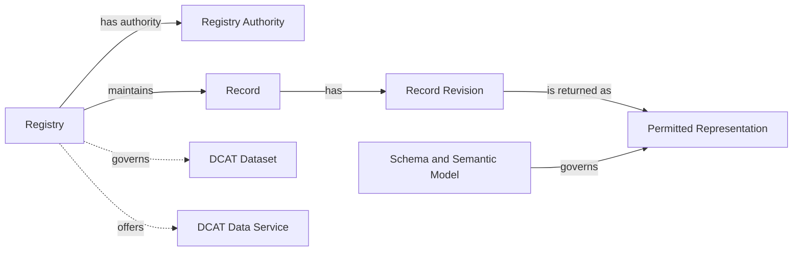

# Registry Core

> **Status:** DRAFT. See [requirement maturity](conformance.md#requirement-maturity).

## Purpose and applicability

Registry Core defines the common behaviour and metadata shared by the API families. It identifies the Registry, its authority and scope, and its available services. Returned Records have stable identity within an unambiguous Registry context and a documented representation schema. A capability or domain profile can additionally require revision, lifecycle, provenance, or formal semantic-model information.

Core is the interoperability boundary of this specification. Two implementations that conform to Core and the same capability expose the same operation shapes, error model, pagination, discovery mechanism and Record envelope. They do not expose the same domain fields: each deployment declares its own Record schemas in its published contract, and a domain profile can narrow them. Consumers can reuse protocol and envelope handling across Registries; domain-specific inputs and interpretation still require integration against each published contract.

The [draft conformance model](conformance.md#draft-conformance-model) combines service discovery with at least one selected Registry information operation. Core requirements apply as follows:

- Registry metadata and service discovery apply to every implementation.
- Record representation requirements apply to implemented capabilities that return Records.
- Identifier preservation applies where the implementation assigns or maintains Record Identifiers.
- The OpenAPI Registry context extension applies to selected Collection-scoped Consultation operations.

[Provisioning](roadmap/provisioning.md) describes possible future administrative operations for creating or revising metadata. Publication can also use a static document or an external catalogue.

## Conceptual model



The model describes externally observable concepts. An implementation can operate one or more Registries, each with one or more technical services.

## Registry metadata

Registry metadata describes the institutionally governed Registry and its relationships to datasets, technical services, and catalogues. An implementation publishes it as one JSON document, as described under [Discovery publication](#discovery-publication). The keys below are defined by the [metadata document schema](../api/extensions/registry-metadata.schema.json). The [metadata vocabulary appendix](metadata-vocabulary.md) explains their DCAT and RDF meaning for catalogue integrators; producing or consuming the document does not require RDF tooling.

### Minimal metadata

| Concept | JSON key | Status | Meaning |
|---|---|---|---|
| Registry Identifier | `@id` of the Registry | Required | Globally unique and stable identifier for the Registry. |
| Registry Name | `title` | Required | Human-readable name used by adopters and consumers. |
| Registry Authority | `authority` | Required | Institution accountable for the Registry and its declared authoritative scope. |
| Digital Registries specification reference | `specification` | Required | Identifies the versioned Digital Registries specification used to describe the implementation. |
| Description and authoritative scope | `description` | Required | Describes the information for which the named authority accepts responsibility, including relevant domain or jurisdictional boundaries. |
| Governed dataset | `governedDataset` | Not required and repeatable | A governed collection of Registry Records described for discovery or exchange. |
| Data service | `dataService` | Required for each exposed Registry service; repeatable | Associates the Registry with each interface exposed through the Digital Registries capability model. |

The scope description states the information for which the Registry Authority accepts responsibility and can reference a fuller scope or mandate document. The Registry Authority, Registry Operator, and catalogue publisher are distinct roles that can be held by the same or different organisations. The adopting ecosystem determines how it accepts or verifies authority declarations. Publication alone does not establish institutional responsibility.

The Registry Identifier and `authority` are absolute IRIs. A publisher can use an HTTPS URI under a domain it controls, a URN, or an identifier already assigned by an organisation or dataset register. Consumers compare these identifiers and do not need to dereference them.

`specification` identifies the specification version used to describe the implementation. A formal claim against an applicable approved specification or profile uses `conformsTo`. [Conformance](conformance.md) defines the conditions for such claims.

<a id="service-declarations"></a>

### API family discovery

Each service exposed through the Digital Registries capability model identifies its supported API families with `serviceType` values on its data service description. Each value is a concept from the **Digital Registries API Families** scheme, abbreviated by the `apif:` prefix. Declarations cover Registry services available to the metadata's intended audience.

| `serviceType` value | API family |
|---|---|
| `apif:consultation` | Consultation |
| `apif:provisioning` | Provisioning |
| `apif:evidence` | Evidence |
| `apif:write` | Write |
| `apif:notification` | Notification |
| `apif:aggregate-data` | Aggregate Data |
| `apif:access-transparency` | Access Transparency |
| `apif:identity-federation` | Identity Federation |

An API-family value means that the data service exposes at least one operation assigned to that family. Supported operations are defined in the contract linked by `endpointDescription`. Family classification alone establishes neither support for every operation in the family nor a conformance claim.

Service metadata includes the service identifier, family classifications, `endpointURL`, and `endpointDescription`. The linked contract is machine-readable. HTTP operations use OpenAPI, or a protocol-native machine-readable description where the selected binding defines one. Parameters, request and response schemas, outcomes, and access requirements are defined in that contract. The metadata supports service discovery; automatic selection and invocation of equivalent operations across implementations is outside this discovery model.

A service description declares only the families available for its associated Registry. Where a shared API offers different families for different Registries, each Registry uses a separate logical data service description. Those descriptions can share an endpoint or contract URI.

### API composition

One API can expose several logical Record Collections and operations from several families. A Collection is an addressable API grouping with declared membership, not an assertion that its Records occupy one table, source module, governed dataset, or institutionally separate Registry. Its `collectionId` is stable within the API contract. One Registry can expose several Collections, and one Record can be a member of several Collections while retaining the same identity. Its contract documents each Collection's membership and each operation's inputs, representation, and access requirements. API-family classifications describe capabilities independently of URL structure.

An OpenAPI contract declares the Registry context of each Collection-scoped Consultation operation with the `x-govstack-digital-registries` extension on the Operation Object. The extension requires four values: `registry`, the Registry Identifier, equal to the `@id` of a Registry in the published metadata; `collection`, equal to `{collectionId}` in the operation path or its fixed concrete value; `capability`, one of `retrieve`, `lookup`, `list`, `search`, `revision-list`, and `revision-retrieve`; and `view`, the name of the Record view the operation returns. Its `features` array, which can be omitted, selects the additional guarantees defined by [Consultation](consultation-binding.md#selectable-read-features), including recorded-time, effective-time, and purpose binding; omission or an empty array selects none. An operation selecting `purpose-bound` also declares the extension's `purpose` object. The [extension schema](../api/extensions/x-govstack-digital-registries.schema.json) is its normative definition, and its capability and feature values are closed for that versioned contract. Operations of one Collection that declare the same view return the same Record schema. History operations can declare a distinct view, such as `record-history`. The extension is the machine-readable link between a Record read and the metadata that identifies its Registry and authority; the [Common Record context](#common-record-context) relies on it. The cross-Collection caller capability document has its own bounded schema and references these operations; it does not carry one Registry or Collection extension. Its advisory capability and feature annotations are separately extensible under [Consultation](consultation-binding.md#operations). The `capability` property is binding vocabulary mapped to the framework option keys in the [overview](../introduction/overview.md#functionalities); it is not a framework capability declaration.

```yaml
  /v1/collections/businesses/records/{recordId}:
    get:
      operationId: retrieveBusiness
      x-govstack-digital-registries:
        registry: https://registry.example/registries/business
        collection: businesses
        capability: retrieve
        view: business-public
```

Operations from different families can share a resource URI through distinct HTTP methods. For example, Consultation can retrieve a Record at a URI where Write accepts an update. Each operation defines its own request and response schemas and permissions. The API contract coordinates collection, action, and supporting-resource paths, including any schema, subscription, or asynchronous-operation resources.

The major version applies to the API contract exposed at that root. Separately exposed APIs can evolve under their own versions. Protocol-specific bindings follow their protocol's endpoint and versioning conventions.

### Discovery publication

An implementation publishes its Registry metadata as one document compacted with the version 1 JSON-LD context and served as `application/ld+json`. The [metadata document schema](../api/extensions/registry-metadata.schema.json) defines the compacted shape; the JSON-LD context defines its RDF meaning for consumers that want it. The [adopter kit](adopter-kit.md) lists this document alongside the other published artifacts. The document describes one or more Registries, their governed datasets, and their services. The document URI identifies the document; each Registry has its own Registry Identifier. The document URI is chosen by the deployment, is stable, and is not part of the versioned API surface.

Consumers locate the document through the [RFC 9727](https://www.rfc-editor.org/rfc/rfc9727.html) API catalog. The origin that hosts a Digital Registries API serves `/.well-known/api-catalog` as an [RFC 9264 linkset](https://www.rfc-editor.org/rfc/rfc9264.html) in `application/linkset+json`, following the GET, HEAD, and HTTPS requirements of RFC 9727. For every Digital Registries API at that origin, the linkset carries a `service-desc` link to the OpenAPI contract and a `service-meta` link, typed `application/ld+json`, to the Registry metadata document. Both link relations are defined by [RFC 8631](https://www.rfc-editor.org/rfc/rfc8631.html). The well-known path is one of the unversioned paths the GovStack API Design Guide permits, so no other root path is needed for discovery. The [canonical OpenAPI contract](api.yml) describes `GET` and `HEAD` on this path, including the `Link` header with the `api-catalog` relation, at the origin root outside any deployment routing prefix.

The linkset below publishes the three contracts and the metadata document of the [informative example](#informative-json-ld-example). It is also available as a [file](../api/examples/api-catalog.linkset.json).

```json
{
  "linkset": [
    {
      "anchor": "https://registry.example/",
      "service-desc": [
        {
          "href": "https://registry.example/contracts/1.0.0-draft/examples/business-registry.openapi.yaml",
          "type": "application/vnd.oai.openapi",
          "title": "Business Registry Consultation API"
        },
        {
          "href": "https://registry.example/contracts/business-write.openapi.json",
          "type": "application/vnd.oai.openapi+json",
          "title": "Business Registry Write API"
        },
        {
          "href": "https://registry.example/contracts/business-evidence.openapi.json",
          "type": "application/vnd.oai.openapi+json",
          "title": "Business Registry Evidence API"
        }
      ],
      "service-meta": [
        {
          "href": "https://registry.example/catalog",
          "type": "application/ld+json",
          "title": "Registry metadata for the Business Registry"
        }
      ]
    }
  ]
}
```

An entry in an external catalogue, such as a national data portal, can repeat the metadata but does not replace the well-known resource. Declarations are scoped to the intended metadata audience. Missing declarations establish neither the absence of an undisclosed service nor a consumer's entitlement to use it.

### Informative JSON-LD example

This JSON-LD document describes a business Registry, its authority and governed dataset, and three logical services supporting Consultation, Write, and Evidence at a shared API endpoint. The GovStack context maps JSON properties to the RDF vocabulary and identifies IRI-valued properties. The specification IRI is illustrative; publication status is listed under [coverage and limitations](README.md#coverage-and-limitations).

The Consultation entry illustrates publication of the [business Registry OpenAPI](../api/examples/business-registry.openapi.yaml) with its local dependencies at the example contract URL. It supports Retrieve, Lookup, List, and Search. The document is also available as a [file](../api/examples/registry-metadata.jsonld) and validates against the metadata document schema. Its own URI, `https://registry.example/catalog`, is the `service-meta` target of the linkset above.

```json
{
  "@context": "https://vocab.govstack.global/digital-registries/context/v1",
  "@graph": [
    {
      "@id": "https://registry.example/catalog",
      "@type": "dcat:Catalog",
      "title": "Business Registry catalogue",
      "description": "Discovery metadata for the Business Registry, its dataset, and its APIs.",
      "publisher": "https://registry.example/organisations/business-authority",
      "catalogResource": "https://registry.example/registries/business",
      "catalogDataset": "https://registry.example/datasets/business-records",
      "catalogService": [
        "https://registry.example/services/business-consultation",
        "https://registry.example/services/business-write",
        "https://registry.example/services/business-evidence"
      ]
    },
    {
      "@id": "https://registry.example/registries/business",
      "@type": [
        "govreg:Registry",
        "dcat:Resource"
      ],
      "title": "Business Registry",
      "description": "Authoritative business registrations in Example Jurisdiction, including registered names and registration status. Tax status is outside this Registry's scope.",
      "specification": "https://specs.govstack.example/digital-registries/3.0.0-alpha.2",
      "authority": "https://registry.example/organisations/business-authority",
      "governedDataset": "https://registry.example/datasets/business-records",
      "dataService": [
        "https://registry.example/services/business-consultation",
        "https://registry.example/services/business-write",
        "https://registry.example/services/business-evidence"
      ]
    },
    {
      "@id": "https://registry.example/organisations/business-authority",
      "@type": "prov:Organization",
      "title": "Business Registration Authority"
    },
    {
      "@id": "https://registry.example/datasets/business-records",
      "@type": "dcat:Dataset",
      "title": "Business registration records dataset",
      "description": "Governed collection of business registration Records.",
      "publisher": "https://registry.example/organisations/business-authority"
    },
    {
      "@id": "https://registry.example/services/business-consultation",
      "@type": "dcat:DataService",
      "title": "Business Registry Consultation API",
      "description": "Retrieves, looks up, lists, and searches permitted business Records.",
      "serviceType": "apif:consultation",
      "servesDataset": "https://registry.example/datasets/business-records",
      "endpointURL": "https://registry.example",
      "endpointDescription": "https://registry.example/contracts/1.0.0-draft/examples/business-registry.openapi.yaml"
    },
    {
      "@id": "https://registry.example/services/business-write",
      "@type": "dcat:DataService",
      "title": "Business Registry Write API",
      "description": "Accepts governed requests to create or revise business Records.",
      "serviceType": "apif:write",
      "endpointURL": "https://registry.example",
      "endpointDescription": "https://registry.example/contracts/business-write.openapi.json"
    },
    {
      "@id": "https://registry.example/services/business-evidence",
      "@type": "dcat:DataService",
      "title": "Business Registry Evidence API",
      "description": "Produces signed assertions derived from permitted business registration information.",
      "serviceType": "apif:evidence",
      "endpointURL": "https://registry.example",
      "endpointDescription": "https://registry.example/contracts/business-evidence.openapi.json"
    }
  ]
}
```

The example uses untagged strings for readability. Deployments can use JSON-LD language maps, such as `"title": {"en": "Business Registry"}`, when publishing multilingual labels.

The [metadata vocabulary appendix](metadata-vocabulary.md) explains the RDF types and catalogue relationships used in the example and how the same pattern covers multi-Registry implementations and aggregating national catalogues. An implementation exposing only Evidence uses the same pattern with just the Evidence service in the Registry's `dataService` list and the catalogue's `catalogService` list.

Catalogue entries contain descriptive metadata only. Services govern disclosure of Record information through their access policies.

### Client discovery workflow

A client can discover declared API families without knowing an implementation's API paths in advance:

1. Request `/.well-known/api-catalog` at the API origin as `application/linkset+json`, or start from a configured metadata document URI.
2. Follow the `service-meta` link to the metadata document, request it as `application/ld+json`, and check that the response uses that media type.
3. Select the required Registry by its `@id`, the stable Registry Identifier.
4. Follow `dataService` to each associated data service.
5. Read each service's `serviceType` values, then follow `endpointDescription` for the exact operations and invocation contract.

The following language-neutral pseudocode illustrates the process:

```text
metadataUri = configuredMetadataUri

if metadataUri is absent:
    linkset = get(resolve(apiOrigin, "/.well-known/api-catalog"), accept = "application/linkset+json")
    requireMediaType(linkset, "application/linkset+json")
    metadataUri = firstLink(linkset, rel = "service-meta", type = "application/ld+json").href

response = get(metadataUri, accept = "application/ld+json")
requireMediaType(response, "application/ld+json")
metadata = loadJsonLd(response.body)
registry = metadata.resourceWithId(requiredRegistryId)
discoveredServices = []

for each serviceReference in asList(registry.dataService):
    service = metadata.resourceWithId(serviceReference)

    for each family in asList(service.serviceType):
        if DigitalRegistriesApiFamilies contains family:
            discoveredServices.append({
                family: family,
                service: resourceIdentifier(service),
                endpoint: service.endpointURL,
                description: service.endpointDescription
            })

return discoveredServices
```

`loadJsonLd` parses the document and normalises properties that can contain one or several values; because the document is compacted with the pinned context, a plain JSON parser is sufficient. `DigitalRegistriesApiFamilies` contains the eight `serviceType` values listed under [API family discovery](#api-family-discovery). The example returns three data services supporting Consultation, Write, and Evidence.

The example assumes the selected Registry and its service descriptions are present in the returned graph. Deployments using external descriptions document their retrieval. A service description missing a required family classification or contract reference is incomplete under Core. Operation names alone establish neither a family classification nor a conformance claim.

## Common Record context

Every returned Record representation has the following context. The binding defines where it is conveyed: in the representation, response metadata, or the versioned operational contract and its association with the Registry. The Consultation HTTP binding conveys it through the contract: the `x-govstack-digital-registries` extension on each operation names the Registry, logical Collection, capability, and view, and the operation's response schema is the representation schema. A consumer can determine that context without knowing the source's internal storage. Registry-wide information need not be repeated in every Record or Collection item.

| Concept | Baseline contract |
|---|---|
| Registry Identifier | The operational contract binds the operation to one Registry, or the returned Record explicitly identifies its Registry. |
| Record Identifier | A stable reference unique within that Registry, included in each returned Record. |
| Representation Format | The binding identifies the serialisation or media type. |
| Representation Schema | A resolvable, versioned machine-readable schema identifies the permitted representation; schema selection is unambiguous. |
| Field meanings | Schema descriptions or linked domain documentation explain field meanings, units, code lists, and relevant absence or null semantics. |
| Registry Authority | The Registry context resolves to the authority and authoritative scope published in Registry metadata. |

The applicable capability determines which domain data and metadata the consumer may receive. Each operation has one declared view schema, named in its Consultation Registry context declaration. Access policy can withhold non-required fields within that schema. An operation selecting the selectable Consultation `field-selection` feature can also let consumers request a subset of its declared selectable `data` fields, while retaining Record identity and the `data` object. Its contract documents the default field set and supported selections. Both default and selected responses validate against the same view schema; field selection never grants disclosure rights. A materially different representation uses a separately declared view and operation or API. The HTTP binding uses the same Record envelope and schema for single results and collection members within a declared view.

Collections organise access to Records within the Registry's identity scope. The same Record retains its identifier across Collections, views, revisions, and temporal selections. Distinct Records have distinct identifiers within that Registry, including when their source Collections use overlapping keys. An adapter can qualify such keys with a stable namespace; consumers continue to treat the resulting identifiers as opaque.

A service returning Records from different Registries or schemas makes the distinction explicit for each affected Record. A shared service URL alone does not establish a unique Registry context. An export or portable representation declares any additional context needed when it leaves its original request context.

Record schemas define [structured values and references](#structured-values-and-references), including the identity, ownership, and meaning of embedded data.

**Example: resolving Record context.** In the illustrative business binding, `GET https://registry.example/v1/collections/businesses/records/r_42` returns:

```json
{
  "recordId": "r_42",
  "data": {
    "legalName": "Example Ltd",
    "registrationStatus": "DISSOLVED"
  }
}
```

The metadata above associates that service with Registry `https://registry.example/registries/business` and the Business Registration Authority. The Retrieve operation in the linked OpenAPI declares that Registry, the `businesses` collection, and the `business-public` view; its response schema is `BusinessRecord`, whose `data` follows `BusinessData`. A consumer retaining this Record's identity stores the Registry Identifier together with `r_42`.

## Revisions and lifecycle

The Record Identifier remains stable when the Record changes. Existing source identifiers may be reused when they satisfy the identity and stability requirements. Core does not require an adapter to introduce revision storage, maintain a journal, or mint aliases for already suitable source identifiers.

Revision identifiers, revision recording times, and lifecycle fields are not required in the baseline. When supplied or required by a selected capability or profile, their schema defines their meaning and availability. A source revision identifies a revision accepted by the source; a response hash or HTTP validator does not by itself establish such an identifier. A response timestamp is not the time a source revision was recorded.

The latest information is the most recent accepted information available through the source interface under its documented currency contract. It need not describe an active entity. Domain status fields retain their documented meaning; omitting a generic lifecycle field does not imply an active state. Consultation revision and temporal capabilities require source-backed history and declared semantics beyond the default latest read. Event occurrence and registration dates are not automatically effective-time coordinates.

**Example: stable identity through a status change.** Two current reads of the same business, before and after its dissolution is accepted by the source, return:

| Read | `recordId` | `data.registrationStatus` |
|---|---|---|
| Before dissolution | `r_42` | `ACTIVE` |
| After dissolution | `r_42` | `DISSOLVED` |

The identifier continues to refer to the same Record; its current domain status changes.

## Domain semantics and extensions

Adopters should reuse established domain schemas and vocabularies where suitable, including [Schema.org](https://schema.org/), [EU SEMIC Core Vocabularies](https://interoperable-europe.ec.europa.eu/collection/semic-support-centre/solution/core-vocabularies), and schemas defined or adopted by national and sector authorities. The contract identifies adopted models and versions, preserves their concepts' meanings, and documents field meanings, source mappings, local constraints, and extensions. A separately published formal semantic model is not required unless a selected capability or profile requires it. Representations follow the applicable inherited cross-functional requirements.

Extensions preserve the meaning of required Registry and Record metadata. Compatible schema evolution keeps existing fields and context interpretable; an incompatible representation is identified through a new version or an explicitly selected view. The status of broader compatibility rules is documented under [coverage and limitations](README.md#coverage-and-limitations).

### Structured values and references

Domain schemas distinguish values owned by the containing Record, references to other Records, and embedded representations of related Records. Component identifiers have schema-defined scope. Embedded related representations preserve the target Record's identity and Registry context and declare their source currency. Recorded values retain the meaning assigned by their owning source, including its correction rules.

A Record reference identifies its target Record and Registry unambiguously through the field schema or explicit reference context. Adopted domain reference forms can be used with documented identity, target scope, and resolution semantics. When a target read is offered, the field binding identifies the target collection, operational contract and operation, and how the reference supplies the required inputs. A binding with several possible targets defines how to select the applicable read. Target reads follow the Registry's published capabilities and access policy. Profiles declare any referential-integrity guarantees.

Embedded collection schemas declare bounds. Their contracts define complete permitted views, selected subsets, or pages with continuation; omitted, null, and empty values; and overflow outcomes. A collection declared complete contains every component permitted by that view. Each paginated collection has its own continuation context. Disclosure policy applies to references, embedded data, and completeness information.

**Example: related Record identity.** A field using the illustrative `UnscopedRecordReference` [schema](../api/examples/relationship-examples.schema.json) carries the target Registry explicitly:

```json
{
  "recordId": "person_42",
  "registryId": "https://registry.example/registries/individuals"
}
```

The same schema document defines `IndividualReference`, whose target Registry is fixed to that IRI. A field using it can carry `{"recordId": "person_42"}`. Its illustrative field binding maps `recordId` to the path parameter of the target service's `GET /v1/collections/individuals/records/{recordId}` operation. Reading that reference therefore uses `GET https://registry.example/v1/collections/individuals/records/person_42`, subject to the target service's published contract and access conditions. The binding supplies the route; the identifier remains opaque.

## Requirements

The requirements that use this model are in [Discover Registry Services](../requirements/registry-discovery.md) and [Provide Registry Services](../requirements/registry-services.md). Verification procedures remain in [Testing](testing.md#requirement-traceability).
